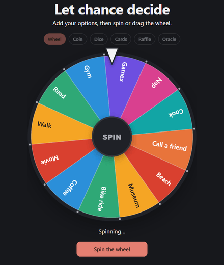
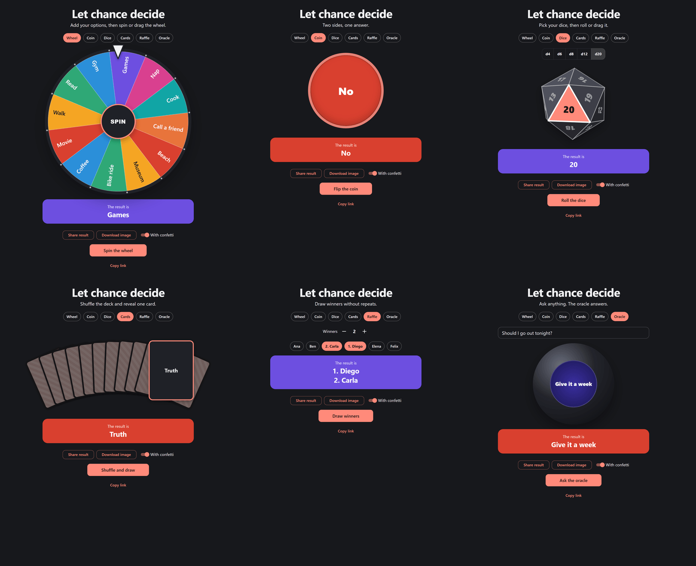
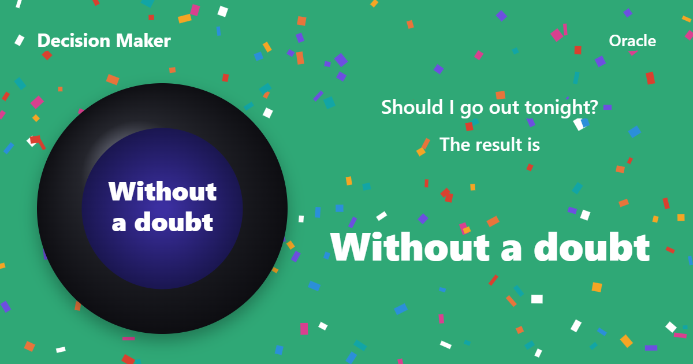
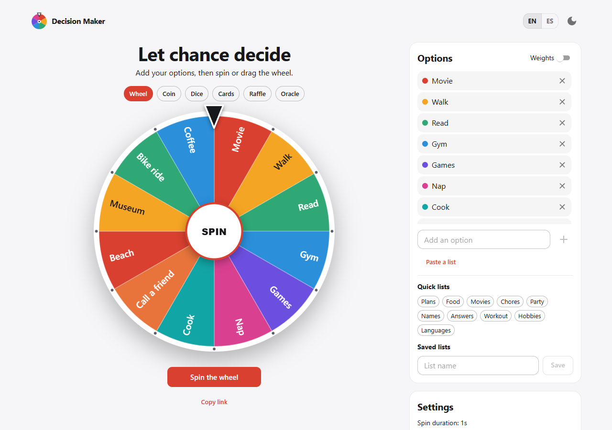

<div align="center">

# Decision Maker

**Let chance decide.** Spin a wheel, flip a coin, roll real 3D dice, draw a card, run a raffle or ask the oracle.

[**Try it live**](https://tletelieru.github.io/decision-roulette/)



</div>

## Six ways to decide



| Mode | How it works |
| --- | --- |
| **Wheel** | Spin it, or grab it and drag it in either direction. Weights make slices bigger. |
| **Coin** | A 3D flip with two sides you can rename, like Heads and Tails. |
| **Dice** | Real d4, d6, d8, d12 and d20 you can turn by hand before rolling. |
| **Cards** | The deck really shuffles, then the winning card flips where it landed. |
| **Raffle** | Draw any number of winners without repeats. |
| **Oracle** | Write a question and get an answer from a list you can edit. |

## Made to be shared

Every result can be shared or downloaded as an image, with or without confetti.



The address bar always holds your current mode and list, so copying the link is all it takes to send someone the same wheel.

## And also

- Saved lists, plus quick lists for plans, food, movies, chores, workouts, hobbies and more
- Bulk paste, weights, and a separate list for each mode
- Spin duration, instant results and an optional stop button
- Sound, confetti and vibration, with a reduced-motion fallback
- English and Spanish, light and dark themes
- Installable and offline as a PWA, with no account and no backend



## Development

```sh
pnpm install
pnpm dev
pnpm lint
pnpm test
pnpm build
```

## License

Copyright (c) 2026 tletelieru. All rights reserved. See [LICENSE](LICENSE).

---

Developed by [tletelieru](https://tletelieru.github.io/tletelieru/) · [GitHub](https://github.com/tletelieru)
